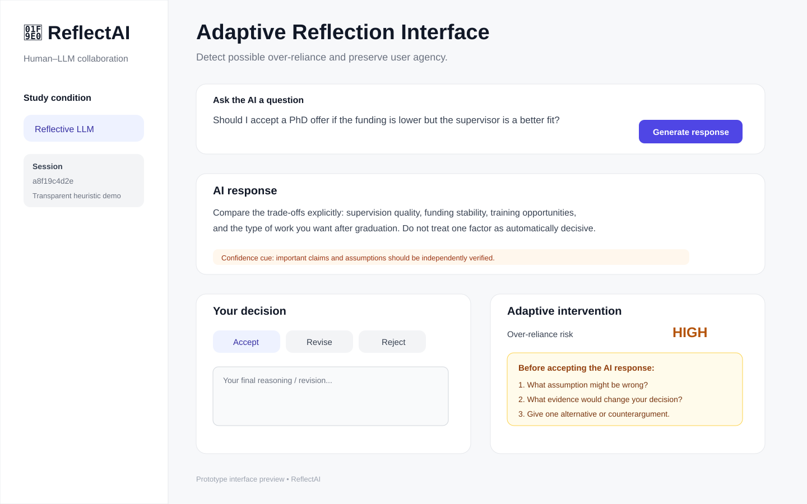
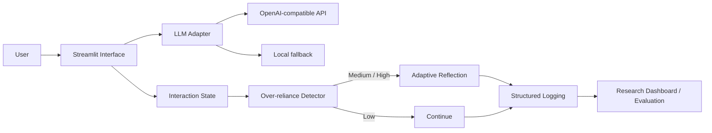

# ReflectAI

> **Adaptive reflection for human–LLM collaboration**

ReflectAI is a research prototype that explores a simple Human-Centered AI question:

> **Can an interface detect possible over-reliance on LLM output and intervene without taking agency away from the user?**

<p align="center">
  
</p>

## Why this project

LLMs can reduce effort and accelerate decision-making, but highly fluent output may also encourage users to accept suggestions with limited independent reasoning. ReflectAI turns that research problem into an **interactive, instrumented prototype** rather than treating over-reliance only as a questionnaire construct.

The current system observes lightweight behavioral signals, estimates a transparent reliance-risk score, and conditionally introduces a short reflection intervention.

## System architecture



## What the prototype demonstrates

| Capability | Implementation |
|---|---|
| **System implementation** | End-to-end Streamlit web application |
| **LLM integration** | OpenAI-compatible chat-completions API with local fallback |
| **Adaptive interface** | Reflection is triggered conditionally from observed interaction behavior |
| **Transparent mechanism** | Risk score uses interpretable signals rather than a black-box claim |
| **Data pipeline** | Each interaction is logged in structured CSV form |
| **Evaluation readiness** | Baseline and Reflective conditions can be compared experimentally |

## Current interaction signals

The demonstration detector uses three interpretable signals:

1. **Acceptance latency** — very rapid acceptance raises the reliance-risk score.
2. **Revision similarity** — accepting an answer almost unchanged raises the score.
3. **Explicit action** — direct acceptance contributes additional evidence.

This detector is intentionally heuristic. It is **not presented as a validated psychological measure**.

## Adaptive reflection mechanism

When the score is medium or high in the **Reflective LLM** condition, the interface asks the user to:

- identify an assumption that may be wrong;
- specify evidence that could change the decision;
- generate an alternative or counterargument.

The design goal is not to block AI assistance, but to restore a small amount of **deliberative friction** at moments where passive acceptance may be more likely.

## Experimental design

A straightforward study can compare three interface conditions:

### Condition A — Baseline
Users receive:
- an LLM response;
- a generic verification / confidence cue;
- the ability to accept, revise, or reject the answer.

### Condition B — Static Reflection
Users receive the same interaction plus the reflection prompt on every trial. This controls for the presence of reflection itself.\n\n### Condition C — Adaptive Reflection\nUsers receive the same interaction, but reflection is triggered only when the transparent behavioral heuristic indicates medium/high reliance risk.

### Candidate dependent variables

- decision accuracy;
- factual verification behavior;
- acceptance latency;
- degree of answer revision;
- calibration of trust;
- perceived agency;
- cognitive effort;
- post-task recall;
- reasoning quality.

### Example hypotheses

- **H1:** Adaptive reflection reduces uncritical acceptance of incorrect LLM suggestions.
- **H2:** Adaptive reflection increases independent revision and verification behavior.
- **H3:** The intervention improves calibrated reliance without substantially reducing perceived agency.

## Research roadmap

The current prototype is deliberately minimal. A research-grade version could extend the system with:

- learned reliance prediction from interaction traces;
- calibrated model uncertainty;
- retrieval-grounded evidence;
- counterargument generation;
- delayed answer reveal;
- keystroke dynamics;
- eye-tracking or multimodal behavioral signals;
- personalized intervention policies;
- longitudinal adaptation.

## Project structure

```text
ReflectAI/
├── app.py                    # interactive research prototype
├── core.py                   # testable reliance-risk and intervention logic\n├── evaluation.py             # simple condition-level summaries
├── requirements.txt
├── README.md
├── tests/                    # unit tests for risk/intervention logic\n├── .github/workflows/ci.yml # compile, unit-test, and Streamlit smoke-test\n├── .gitignore
├── docs/
│   ├── architecture.md
│   └── interface-preview.svg
└── data/
    └── interaction_logs.csv  # generated locally, ignored by git
```

## Run locally

```bash
pip install -r requirements.txt
streamlit run app.py
```

Optional OpenAI-compatible API configuration:

```bash
export OPENAI_API_KEY="..."
export OPENAI_BASE_URL="https://api.openai.com/v1"
export OPENAI_MODEL="gpt-4.1-mini"
```

Without an API key, the application still runs using a local deterministic fallback so that the interface and logging pipeline can be demonstrated.

## Positioning

ReflectAI sits at the intersection of:

**Human-Centered AI · Human–LLM Interaction · Conversational AI · User Agency · Reliance Calibration · Adaptive Interfaces · HCI Evaluation**

## Author

**Lujie Huang**  
Personal website: https://lujiehuang.github.io/

---

*Research prototype. The current reliance-risk heuristic is designed for transparent demonstration and should not be interpreted as a validated diagnostic or psychological assessment.*
